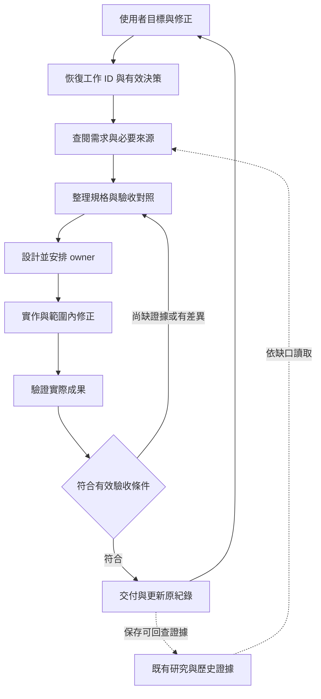
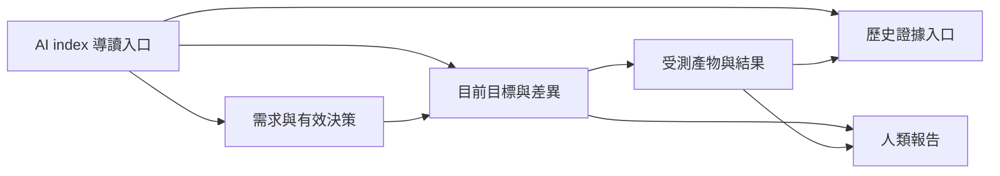
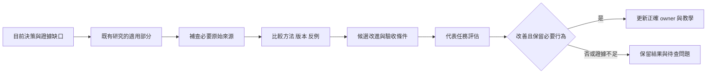

# 可持續的 AI 開發流程

用一個可恢復的工作目標, 串起需求、設計、實作、驗證與修正, 每階段都能看出輸入、產物、負責人與完成條件, 換專案、電腦或對話後仍能找到有效決策與下一步

這份文件說明整體設計與判斷方式, 實際操作見 [開發流程](workflow.md), 設定還原見 [跨電腦工作流](shared-workflow.md), Prompt 見 [提示詞範例](prompts.md), 文件內的名稱與資料皆為示範, 先沿用專案已有的紀錄

## 從輸入到成果

| 階段 | 輸入 | 產物 | 負責與完成條件 |
|---|---|---|---|
| 恢復 | 目前要求、既有工作 ID、現況文件、checkout / diff | 有效目標、授權、差異與下一步 | Main 核對記錄和實體, 不以聊天結束判定完成 |
| 閱讀與收集 | 原始規格、相符抽出版、畫面、介面與必要研究 | 來源位置、適用版本、缺口及衝突 | 可追溯到頁碼、工作表、章節或實際程式 |
| 需求整理 | 操作情境、欄位、文案、狀態及限制 | 需求與驗收對照、必要的需求檔 | 已知需求可驗收, 未定規格保持明確 |
| 設計與分工 | 需求、資料/state owner、既有元件與公共介面 | 有邊界的工作單位、相依與責任 | Main 決定跨模組事項, 可獨立部分才考慮委派 |
| 實作 | 已確認設計、可改檔案、既有模式與驗收 | 程式、設定或文件, 以及對應檢查 | 同一 owner 完成閱讀、修改、檢查與範圍內修正 |
| 驗證 | 原始驗收、實際產物、代表資料與環境 | 每項結果與證據, 保留失敗及未驗證 | 測試指向受測內容, 不能只寫通過數量 |
| 整合驗收 | 各 owner 產物、有效決策、必要門檻 | 已驗收 / 待驗收 / 受阻項目 | Main 核對整體需求與跨元件影響 |
| 交付 | 已驗收成果、必要待辦、獲准目的地 | 人類報告、既有現況與歷史更新 | 程式完成、Git 交付、安裝載入、部署分開確認 |
| 迭代 | 使用者修正、實測問題、適用的新研究 | 取代決策與受影響工作 | 保留有效成果, 只重查相依的實作與證據 |

流程透明化要能回答 "依哪份輸入、作了什麼選擇、改了什麼、如何證明、還缺什麼", 保存可觀察的決策摘要與證據即可, 不依賴模型內部推理紀錄或完整對話逐字稿

## 需求要拆到什麼程度

先看現有目錄, 再依來源權威、功能責任、讀者與更新頻率分檔, 小修改可使用同一文件中的章節, 不需要為每個欄位、頁面或 Agent 建一份檔案

例如一個需要長期維護的查詢與編輯功能, 可以有以下分工, 檔名依專案沿用:

| 文件用途 | 要保存的內容 | 拆分條件 |
|---|---|---|
| 原始來源與抽出版 | 來源識別、版本/hash、頁碼/工作表、擷取範圍 | 原始格式不便閱讀或需要多次重用 |
| 功能需求 | 操作情境、版面、文案、欄位與狀態 | 不同功能可以分別閱讀與驗收 |
| 介面規格 | Request / Response、空值、錯誤、相容性 | 有獨立介面 owner 或被多個功能使用 |
| 共通規則 | 共用驗證、身分與流程不變條件 | 多處使用, 應避免複製後各自修改 |
| 決策與待定事項 | 已確認更正、被取代部分、來源衝突 | 規格無法單獨表達目前有效決策 |

每個需要驗收的需求都保留"需求 ID → 來源 → 決策 → 實作 → 檢查"的路徑, 尚未查到實作或沒有證據就標明缺口, 不先補成已完成

| 示範 ID | 需求 / 來源 | 實作責任 | 驗收與證明範圍 |
|---|---|---|---|
| DEMO-01 | 查無資料時保留查詢條件, 需求第 2 節 | 查詢頁 owner | 實際操作空結果, 條件仍保留 |
| DEMO-02 | 保存後重新開啟顯示新值, 介面第 4 節 | UI 與 API 各自 owner, Main 整合 | Mock 可驗 mapper, 真實保存重開另驗 |
| DEMO-03 | 按鈕使用指定文案, 畫面第 1 節 | UI owner | 受測畫面文字與來源逐項比對 |

這些是範例, 並非已執行結果, 文案、欄位型別、單位、精度、null / 省略 / 空陣列、權限與錯誤條件保留原意, 版面無法從抽出文字判讀時, 補看相關原件畫面

## AI index、人類報告與歷史如何分開

檔案布局、文件產出規格、跨格式檢查及個人/協作者的閱讀方式見 [文件與慣例](documentation.md), 以下先說明每份內容的責任

| 閱讀面向 | 內容與更新條件 | 保留詳細程度 |
|---|---|---|
| AI index | 任務對應入口、來源權威、穩定限制, 路徑或責任變動才更新 | 精簡, 不複製進度與完整規格 |
| 需求 / 決策 | 精確規格、來源位置與適用範圍, 來源或決策改變時更新 | 影響正確性的內容完整保留 |
| 目前狀態 | 長期目標、有效決策、差異、owner、相依、驗收與下一步 | 保存現在需要採取行動的內容 |
| 人類報告 | 成果、影響、實際證據、未解事項與必要決策 | 結果先行, 細節連回原始證據 |
| 歷史 / 證據 | 重要更動、受測版本、環境、輸入、失敗與取代關係 | 可回查與重現, 不逐則記錄聊天 |

相同狀態只在原紀錄維護, 其他文件引用, 可以同檔分節, 也可因讀者與維護責任分檔, AI 專用內部導讀預設精簡英文, 人類文件預設繁體中文, 原文、技術名稱與 parser 格式保留

要完整保存的是授權、規格文案、公開介面、衝突、失敗原因、驗收缺口與相容性限制, 已穩定背景、重複理由、例行工具操作與未受影響的通過結果可摘要, 不以固定字數刪去關鍵條件

回查從問題與工作 ID 開始, 依序找目前來源、對應決策、歷史證據與必要 Git diff, 只有出處仍不清楚時, 才找相關封存對話的使用者決策與成果, 對話標題可協助定位, threadId 才是識別, 封存、無法存取與完成各自判定

原失敗紀錄保留, 後續修正使用連結指出取代關係, 目前自動摘要可以收斂, 既有 append-only 歷史則另加更正入口, 不覆寫成從未失敗

## 持久性與時效性分開管

| 資料 | 保存方式 | 何時重新核對 |
|---|---|---|
| 長期目標、決策、延期及驗收條件 | 既有核准紀錄, 保持工作 ID | 明確更正、取代、取消或來源衝突 |
| 規格與抽出版 | 來源位置、修訂、hash 與覆蓋範圍 | 規格更新、抽出缺漏、畫面或格式矛盾 |
| 實作與測試證據 | 受測 commit 加相關未提交內容/hash、輸入、環境與結果 | 相關程式、bundle、資料或環境改變 |
| 研究結論 | 問題、適用情境/版本、原始來源與查核日期 | 新版本、矛盾、新問題或明確要求查證 |
| session、連線、可用工具與執行 owner | 目前執行脈絡, 不保存憑證值 | 換裝置、重連、新用戶端或相依操作前 |
| 安裝、載入、遠端 Git 與部署 | 個別目的地的實測結果 | 宣稱目前狀態或開始相依操作前 |

"保存很久"與"現在仍正確"是兩件事, 目標不會因換對話失效, 服務可連線卻可能下一次就改變, 同一 HEAD 也可能有不同未提交內容或舊 bundle, 必須辨認真正受測產物

查找紀錄沿用來源/查詢範圍、上次查核時間、建議回查時間, 實查成功才更新時間, 只讀紀錄或查詢失敗不更新, 回查日期是建議, 不代表期限內所有專案都已查齊

最小回查先列出待判定問題, 只讀能補足它的來源與相依, 例如欄位語意有疑問就回到對應規格/實作, 舊畫面不一致就核對實際載入資產與該情境, 有失敗才沿受影響範圍擴大, 必要的整合或發布門檻仍保留

### 來源變更與採用影響

在原研究或決策紀錄保留這條關係: `來源識別與版本 → 支持的結論及限制 → 採用決策 → 規範/實作位置 → 驗收證據`, 查找紀錄保持精簡, 詳細內容連回同一份主題紀錄, 不另建一套狀態表

區分首次發布、修訂、取得與實際核對時間, 同一篇論文的不同版本、官方更正與多篇轉述要能歸到原來源, hash 能識別內容, 是否改變結論仍需讀取相關差異, 沒有版本或可信日期時保留未知

| 新資訊 | 應處理的影響 |
|---|---|
| 原研究修訂降低結論確定性, 或更正數據 | 標出依賴舊結論的決策與教學, 重查該論證及必要驗收, 保留舊版出處 |
| 新方法在不同模型/任務更好 | 先列候選與適用差異, 用相符案例判斷是否採用, 不自動取代原基準 |
| 官方能力、介面或支援環境改變 | 找出受影響的設定、工具入口與消費端, 核對目標版本後驗證實際操作 |
| 只有重貼、標題或頁面時間改變 | 去重或更新來源資訊, 沒有新證據就不改採用結論 |
| 來源失聯或本次只查到部分 | 保留上次成功核對及本次缺口, 不標成已更新或證據已失效 |

結論可標為候選、已採用、待重查或已取代, 新證據使它待重查不代表相關工作自動取消, owner 按影響決定需暫停的相依部分, 其餘已驗收成果繼續有效, 實際版本差異案例見 [近期研究比較](research.md#近期相依研究與不同實務的比較)

## Global、Agent、Skill、Plugin 與 MCP 的分工

| 機制 | 解決的問題 | 不應承擔的內容 |
|---|---|---|
| Global AGENTS | 跨專案偏好、授權與資料界線 | 目前進度、裝置路徑、每個專案細則 |
| Root / nested AGENTS | 專案架構、owner、入口、既有驗證與例外 | 重複整份 Global 或長篇操作手冊 |
| Subagent role | 一類工作的責任、可改範圍與回報要求 | 常駐服務、額外授權或每功能一個角色 |
| Skill | 何時啟用的可重用判斷與工作方法 | 每次都必跑的工具套餐 |
| Reference / template | 按需讀取的細節或可填內容 | 另一份互相競爭的規格與進度 |
| Plugin | 一起安裝與更新的相關能力 | 執行 owner、獨立規格來源或成功證明 |
| MCP | 有需要的結構化工具、資源與用戶端存取 | 只為包裝既有指令而複製核心邏輯 |
| CLI / API | 可重現的操作與確定性檢查 | 自動擴張安裝、帳戶或發布權限 |

規則移到最窄的有效範圍, 重複內容保留一個來源, Skills 是否合併取決於觸發情境、產物、權限與維護責任, Plugin 是否合併則看分發與相依, 不要求兩者一對一, 新 MCP 需要具體能力缺口, 已有可用 CLI 或正式 API 時先沿用

## Agent 何時分、何時合

| 情境 | 分工選擇 | 驗收責任 |
|---|---|---|
| 小修改或需要大量既有決策 | Main 直接完成 | Main |
| 一個未查清的程式或來源問題 | 允許時用唯讀 Explorer | 回答附證據位置與未知 |
| 邊界明確的獨立功能 | 一位 Worker 完成閱讀、實作、檢查與修正 | Main 整合驗收 |
| 有具體跨介面或安全風險 | 允許時增加獨立 Reviewer | 依原需求與實際差異判斷 |
| 數份文件事實已定, 可獨立校對 | 可交文件 owner | 不能代替程式驗收 |
| 同一 state / API / 設定被多人修改 | 合回同一 owner 或排成依序 | 前 owner 停止後再接手 |
| 長期獨立成果需自己接續 | 明確授權後新對話或沿用既有對話 | 保持自己的工作 ID 與紀錄 |

Main 保留需求、架構、跨專案決策與最終驗收, 不固定建立讀需求、規劃、寫程式、測試、寫報告五種 Agent, 分工要減少可觀察的等待或閱讀負擔, 不能只增加回報層級

跨儲存庫仍是各自的 Git、版本與檢查, manager 協調 owner, 共用安裝、設定、測試資料、ports 與瀏覽器 session 要有單一 writer 或隔離安排, 新角色檔只表示有設定, 真正啟動、載入權限與驗收分別檢查

### Hierarchy agents 的適用範圍

先分開兩種層級: Global / 專案 / 子目錄是工作規範的適用範圍, Main / 協調者 / Worker 是執行責任, 目錄更深不代表要多生一層 Agent, 角色檔也不會自行啟動管理服務

設計前先盤點既有的協調對話、獨立工作對話、role 設定、實際派工與回傳證據, 不因只看到目前主對話或六份角色檔就推論沒有階層分工, 也不把規劃中的結構寫成已執行

長期協調者可以協調經授權的獨立工作對話, 各工作對話再按當次權限使用原生子 Agent, 兩種關係分開記錄: 前者是跨對話的責任關係, 後者有原生父子工作識別, 不以同名標題推定 parent-child, 不因曾經派工就推定目前仍在執行

| 執行結構 | 適用情境 | 保留的責任 |
|---|---|---|
| Main 直接完成 | 小工作、規格耦合或需要大量共同脈絡 | 同一 owner 讀取、修改、檢查與修正 |
| Main 與一層獨立 Worker | 輸入與可改範圍明確, 可獨立交付 | Main 決定共享介面、整合及最終驗收 |
| Main、局部協調者與 Worker | 已授權的大型獨立交付, 局部有實際整合責任, 能減少 Main 的協調負擔 | 局部協調者只處理獲派範圍, 架構、跨 owner 與需求變動回 Main |

本流程預設由一個 Main 協調來源、工具與教學的 owner, 使用既有 workspace manager 時沿其獲派責任工作, 不同時建立功能相同的常駐 orchestrator, 也不為每個儲存庫固定增加管理 Agent

確實需要階層分工時, 每一條父子關係都帶著工作 ID、有效決策版本、可讀/可改範圍、產物、驗收、相依、停止條件與可用資源限制, 子工作不擴張權限或自行遞迴派工, 實際深度、並行量與預算依目前介面及授權設定, 不套固定層數

上層更正先辨認受影響的子工作, 停止衝突寫入並同步有效決策, 只重驗相依成果, 子工作回傳實際檔案/差異與證據位置, 不能只傳一句完成, 下層阻礙先分類並向具決策權的 owner 提出, 不以多層重試放大同一失敗, 取消與資源清理沿原 ownership 傳遞

判斷是否保留中間層時比較協調、重複閱讀、資訊遺漏、整合返工及已驗收成果, 上層仍可按缺口讀原始證據, 一層只是轉述另一層時就合併責任, 階層設計是本流程的有條件方案, [多 Agent 研究](research.md#近期相依研究與不同實務的比較) 未提供可直接套用到所有專案的最佳結構

## 換電腦、遠端、雲端與 dots

先辨認四件事: 誰協調、在哪裡執行、來源與記錄存在哪裡、成果要送到哪裡, 同帳戶、同模型或相同資料夾名稱不能代替這些核對

| 工作方式 | 接續前的重點 |
|---|---|
| 本機新對話 | 讀既有目標/決策, 核對真實檔案與差異 |
| 另一台個人電腦 | 用 repository identity 與相對路徑定位, 比對 revision/hash、本機差異與權限 |
| Remote handoff | 目的主機有相符的已保存專案與 repository 子目錄, 核對轉移後 Git 及 local-only 內容 |
| Cloud task | 使用已設定且有權限的雲端環境, 確認來源、相依與產物保存位置 |
| Dot | 延續既有責任與原 task/host, 讓可用來源與下一步明確 |

[官方 remote handoff](https://learn.chatgpt.com/docs/remote-connections#hand-off-a-chat-between-hosts) 目前要求目的主機有對應專案, 且不支援 handoff 到 Codex cloud, [Dots 官方文件](https://learn.chatgpt.com/docs/dots/tasks-and-memory) 說明, 改選電腦不會搬走既有 task, 新 task 也不自動取得所有 dot 對話, 本段於 2026-10-13 核對, 實際帳戶與裝置可用性仍要在目的端驗證

跨裝置帶走的是可驗證的來源與接續資料: 工作 ID、repo / branch / revision、必要未提交及忽略檔案、有效決策、驗收證據和下一步, 憑證、登入 session 與裝置權限在目的端處理, 原 owner 是否還在寫入、來源是否已保存/推送、用戶端是否載入都分開確認

離線或中斷時保留待辦, 回來後比對內容與 owner 再接續, 保存結果不明先讀回, 有衝突則重新合併相同項目, 不以最後寫入覆蓋他人內容, 也不盲目重送上傳、訊息或排程

## Space 的使用原則

Space 可作為核准的個人目標、研究結論、設定入口與跨裝置導覽, 程式與工具由儲存庫維護, 公司資料留在核准環境, 不把 Space 當所有專案的共同資料出口

同一工作沿用 Page ID 與工作 ID, 有實質決策、差異、阻礙或驗收變動才寫入, AI index 可指向原始內容, 人類報告可連到證據, 不要在不同 Page 再維護相同百分比或待辦狀態

寫入前讀目前 block / revision / hash, 衝突時重讀並合併受影響區塊, 寫後讀回, 對於保存結果不明的操作先查狀態, 不重複建立, 保留人工內容、原始附件與未解問題, 研究結果依主題與版本整理, 不每天新增相同摘要

Dot notes、ChatGPT memory、Page、專案檔案與對話各有用途, 不能當成同一份同步儲存, 固定時間工作需要已保存的排程, 排程狀態與每次執行結果分開看, 優先沿用既有收集器, 沒有新的持續工作授權就不另建排程

## UI/UX 原則與專案特例

共用原則保存操作是否清楚、資訊層級、回饋、錯誤恢復與既有鍵盤/焦點行為, 專案規格決定實際文案、欄位、布局、角色與狀態, 設計系統決定可重用元件與 tokens, 一項專案例外記錄適用範圍、依據、理由及重查條件, 不提升成所有專案通則

無既定設計系統且需找參考時, 現行 UI/UX Skill 從 Apple HIG、Google Material 的相關條目開始, 這是探索順序, 採用仍要符合目標平台、現有元件、需求與授權, 已有設計系統就沿用, 不為套通用準則整批換樣式

驗收分開看版面、文案、欄位驗證、欄位狀態與互動, 再依需求補資料流、取消、過期回應、空結果、錯誤、權限與保存重開, 用實際頁面及代表資料核對, 截圖生成成功、HTTP 200 或版面看起來合理都不代表整段流程通過

若採進度百分比, 先明定項目、權重與不適用處理, 未驗證保持未知, 各專案自己確認計分規則, 不把測試通過率當成功能完成率

## 收集資料如何變成可用改善

官方文件確認產品能力, 論文提供方法與受測範圍, 社群及 Power User 案例提供實務問題與假設, 追到原始版本、方法、反例與條件, 多篇轉貼同一來源不算獨立證據, 沒有共同任務和環境, 不把速度、自述成功或人氣換算成你的改善率

採用前先判斷問題屬於需求、程式、環境、資料、來源過時或工作規範, 修正對應 owner, 不把每次失敗都變成 Global 新規則, 同條件比較已驗收結果、返工、漏項與實際成本/時間, 未量測就保留未知

來源與採用條件見 [研究依據](research.md#持久流程與指示效果), 研究更新先形成候選決策, 不自動授權修改程式、安裝工具或發布

### 用排程維護證據

持續採集適合交給有界線的既有排程, 規劃時先辨認主題 owner、來源群組、資料權限、執行主機、頻率、輸出位置、通知及停止條件, 核對實際排程 ID 與啟用狀態, 已停用或被取代的工作保留原決策, 文件列出的數量不等於 live 排程

每次執行從上次成功核對範圍接續, 檢查相關來源新版本與相依研究, 按穩定來源識別去重, 比較方法、結論和限制的差異, 產出新增/變更證據、受影響採用位置及仍缺範圍, 不以每天抓取相同文章維持更新假象, 重讀或失敗不刷新成功時間

採集與採用各有責任: 收集器整理證據, 主題 owner 判讀矛盾與提出候選, 實作 owner 在已授權範圍內修改並驗收, 這是工作責任, 不要求三個 Agent, 同一 Page/索引保留一個 writer 或使用有版本防護的依序合併, 保存結果不明先讀回

斷線後依來源風險及目前決策缺口補查, 不一次重播所有排程或堆積每日摘要, 原有時程是否調整另按實際負荷決定, 未取得的來源保留阻礙與下次條件, 執行成功、資料變新與採用結論通過分開記錄

未要求例行回報時, 無變化或尚不可行的結果保持安靜, 只在結論實質改變、影響現行工作、重要來源持續失效、完成或需要使用者決策時通知, 附影響、證據與最小下一步, 同一未變阻礙不重複提醒, 提醒不增加帳戶寫入、安裝、發布或持續收集的授權

## Git 交付與臨時補充

工作目標與 Git 分支各自有用途, 一個目標可能涉及多個獨立儲存庫, 每個儲存庫分別核對 branch、未提交差異、owner、驗收和交付規則, 不能因一個共用父目錄就當作同一個專案

程式完成、檢查通過、commit、push、Tag、Release 與部署分開回報, 在需要宣稱遠端目前狀態時核對實際遠端, 不以舊 tracking ref 或聊天中的 SHA 當成最新證據, Git 操作依當次授權, 產生 message 不等於執行授權

有並行修改時, 先看全部差異再只處理自己負責的檔案或 hunks, 不順便納入 unrelated work, 衝突保留原內容與決策依據, 已發布歷史、Tag 和保護規則不因一般交付要求改寫

偶爾補充的小事先分類, 再放到最接近用途的位置:

| 補充類型 | 處理方式 |
|---|---|
| 本次需要做的事 | 納入目前工作範圍與驗收, 保持優先順序 |
| 修正既有要求 | 指出取代項目, 更新受影響實作、證據與 owner |
| 有價值但本次延期 | 沿既有待辦 ID 留下原因、owner 和重啟條件 |
| 只在某專案適用 | 放專案慣例或特例, 不擴大成 Global |
| 可反覆使用的個人偏好 | 明確保存授權及適用範圍後, 更新正確的可版控來源 |
| 單次嘗試或尚未證實的點子 | 保留候選與判斷條件, 不當作有效規格或常駐規則 |

可以主動提出漏掉的恢復、資料保留、失敗路徑、相依與驗收問題, 建議說明影響和最小可驗證下一步, 不因想到一個工具就安裝, 也不因待辦很多就替使用者新增排程或對話

### AI 漏項後如何修正

對涵蓋多個面向的工作, 在既有需求/驗收對照保留「要求 → 已讀來源範圍 → 判斷或產物 → 實際證據 → 缺口」, 使用者舉例只作入口, 另依目標檢查相依、失敗恢復、資料生命週期與完成條件, 讀過某份文件不代表其中每個問題都已查到

使用者指出遺漏時, 先定位漏掉的要求與來源, 區分未讀、讀取過時、查詢沒涵蓋、摘要漏掉或推論過頭, 補查能判定的最小證據, 修正相依設計、產物及原紀錄, 收尾明列更正後的結論, 不能只口頭承認就繼續原方案

例如討論 Agent 階層時, 角色檔只能證明設定存在, 實際呼叫及回傳才能證明曾派工, 分工對話的責任又需原授權或交接紀錄, 三者應一起核對, 不以幾次近期執行未派工推論整個專案從未使用

相同漏項反覆發生, 才在原 owner 補精簡入口、針對性檢查或代表失敗案例, 先驗證能抓到原遺漏, 不增加每輪全量掃描、固定多 Agent 審查或一大份必讀清單, 推薦改善時說明證據及適用範圍, 未確認習慣不自動寫成長期記憶

## 用一個小工作驗證整套流程

Goal / Plan、跨模型或跨 AI 接續、漂移控制與數值設計的具體選擇見 [進階工作方式](codex-advanced.md), 以有效規格和驗收基準承接模型更新, 不把某個模型的偏好當成專案規格

下 Prompt 時先給工作 ID / 目標、可用來源、交付類型與可觀察驗收, 已由專案保存的規則直接引用, 不用重貼完整歷史, 範例及每輪回報格式見 [整段流程與每輪回報](prompts.md#整段流程與每輪回報)

執行中的更新交代已知結果、剩餘不確定性與下一步, 本輪回覆則交代輸入與決策、實際產物、證據、整體尚缺與接續方式, 空項省略, 只有整個有效目標都驗收後才標示目標完成

選一個合成資料即可操作的小功能, 使用既有工作 ID, 不另建大型平台, 驗收依序確認:

1. 從入口找到原始需求、有效決策與下一步, 不需閱讀所有歷史
2. 依需求完成實作, 每項結果能連回受測產物與證據
3. 中途更正文案或資料格式, 只取代衝突決策, 重驗受影響部分
4. 在獲准的新對話或目的裝置恢復相同 ID, 核對未提交內容與環境後接續
5. 用人類報告說清楚已驗收、未驗證與下一步, 歷史仍能查到原失敗或舊決策

文件與結構檢查、人工流程檢視、模型實際操作、目的裝置驗收分開回報, 規範寫好只完成流程來源, 後續仍須以真實使用結果決定要精簡、拆分或修正哪些部分
